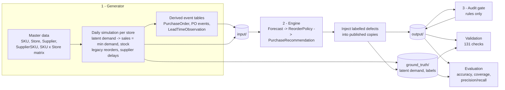
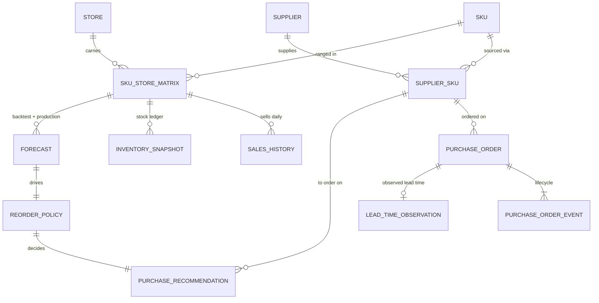

# SKU-Location Demand Forecasting & Replenishment

An end-to-end, reproducible solution that **forecasts daily demand for every SKU in every store** and **recommends purchase orders** that respect supplier lead times, safety stock, MOQs, pack sizes and store capacity. Every decision and exception is explainable.

It has three parts:

1. **A synthetic data generator.** It produces 10 related entities: SKUs, stores, suppliers, contracts, daily sales, inventory, purchase orders and lead times. The data includes seasonality, festivals, promotions, product launches, discontinuations, supplier delays and stockouts.
2. **A forecasting and replenishment engine.** It reads only the input tables and produces forecasts, reorder policies and purchase recommendations.
3. **Audit, validation and evaluation.** These prove the data is consistent, catch every deliberately injected defect, and measure forecast and replenishment quality against a ground truth that the engine never sees.

> All data is synthetic, generated from seed `20261022`. A 30-day sample is committed in [`data/sample/`](data/sample/). The full 2,000 SKU × 100 store × 365 day dataset regenerates with one command.

---

## 1. Quick start

```bash
pip install -r requirements.txt            # numpy, pandas, pytest - nothing else

python main.py run --profile sample        # 30-day sample  (~3 s)  -> data/sample/
python main.py run --profile dev           # 365 days, 300 SKUs x 20 stores (~1.5 min)
python main.py run --profile full          # 365 days, 2,000 SKUs x 100 stores (see section 10)

python main.py reproduce --profile sample  # generate twice, compare SHA-256 of every file
python -m pytest                           # 15 tests: business rules + end-to-end
```

Each `run` performs the whole workflow and prints a one-line verdict, for example `validation 131/131 passed`. Useful options are `--seed`, `--skus`, `--stores`, `--days` and `--out`.

**Where to look first:**

| If you want to... | Open |
|---|---|
| See headline results | [`data/sample/reports/evaluation.md`](data/sample/reports/evaluation.md) |
| See every validation check | [`data/sample/reports/validation_summary.csv`](data/sample/reports/validation_summary.csv) |
| Read the purchase decisions | [`data/sample/output/purchase_recommendation.csv`](data/sample/output/purchase_recommendation.csv) (see the `rule_trace` column) |
| See exceptions for planners | [`data/sample/output/audit_exception.csv`](data/sample/output/audit_exception.csv) |
| Understand every field | [`data/sample/docs/data_dictionary.md`](data/sample/docs/data_dictionary.md) |
| Load into a database | [`data/sample/sql/schema.sql`](data/sample/sql/schema.sql) + [`seed.sql`](data/sample/sql/seed.sql) (SQLite) |

---

## 2. How the workflow fits together



**Separation rule:** the engine and the audit gate read only `input/` and `output/`. Only validation and evaluation may read `ground_truth/`. Ground truth therefore never leaks into features, and validation enforces this with a dedicated check.

---

## 3. Data model



| Entity (table) | Layer | Primary key | Key relationships / cardinality | Lifecycle / effective dates |
|---|---|---|---|---|
| SKU (`sku`) | input | `sku_id` | 1:N SupplierSKU, 1:N matrix | `launch_date`, `discontinue_date`; `active` → `new_launch` → `discontinued` |
| Store (`store`) | input | `store_id` | 1:N matrix | `open_date`; `active` / `new_store` |
| Supplier (`supplier`) | input | `supplier_id` | 1:N SupplierSKU | reliability tier A/B/C |
| SupplierSKU (`supplier_sku`) | input | `supplier_sku_id` | **bridge SKU ↔ Supplier (N:M)**; priority 1 = primary, 2 = backup | `effective_from` / `effective_to`, `is_active` |
| SKU × Store matrix (`sku_store_matrix`) | input | (`sku_id`, `store_id`) | **bridge SKU ↔ Store (N:M)**, complete grid | `ranged` → `phase_out` → `delisted`; `not_ranged` |
| SalesHistory (`sales_history`) | input | `sale_id` | N:1 matrix pair | one row per sellable day |
| InventorySnapshot (`inventory_snapshot`) | input | `inventory_snapshot_id` | N:1 matrix pair; 1:1 with the sales row | daily ledger |
| PurchaseOrder (`purchase_order`) | input | `po_id` | N:1 SupplierSKU | `open` / `received` (derived from events) |
| PurchaseOrderEvent (`purchase_order_event`) | input | `event_id` | N:1 PO (append-only history) | `CREATED` → [`DELAYED`] → `RECEIVED` |
| LeadTimeObservation (`lead_time_observation`) | input | `lead_time_observation_id` | **1:1** with received POs | — |
| Forecast (`forecast`) | output | `forecast_id` | N:1 pair | `backtest` (holdout) and `production` |
| ReorderPolicy (`reorder_policy`) | output | `reorder_policy_id` | 1:1 production forecast; N:1 SupplierSKU (optional) | valid for the forecast month |
| PurchaseRecommendation (`purchase_recommendation`) | output | `purchase_recommendation_id` | 1:1 policy | status enum, see section 5 |
| AuditException (`audit_exception`) | output | `exception_id` | references any entity | `data_defect` / `operational` |
| GroundTruth + DemandActual + DemandProfile + SupplierDisruption | ground_truth | see dictionary | labels only | — |

The full field-level dictionary is generated from one source, [`replenishment/schema.py`](replenishment/schema.py), into [`docs/data_dictionary.md`](data/sample/docs/data_dictionary.md), `data_dictionary.csv` and `relationships.csv`. It covers type, required/optional, allowed values, unit, uniqueness and validation rule. The SQL DDL and the generic validation checks are generated from the same schema, so the documentation cannot drift from the data.

### ID conventions (deterministic, immutable, zero-padded)

| Entity | Format | Example |
|---|---|---|
| SKU / Store / Supplier | `SKU-######` / `STORE-######` / `SUP-####` | `SKU-000042`, `STORE-000007`, `SUP-0003` |
| Sale / Inventory | `SALE-<store>-<sku>-<yyyymmdd>` / `INV-...` | `SALE-STORE-000001-SKU-000042-20251215` |
| Forecast | `FC-<store>-<sku>-<yyyy-mm>` (month of horizon start) | `FC-STORE-000001-SKU-000042-2026-01` |
| Purchase recommendation | `PO-<year>-######` (the reserved PO number) | `PO-2026-000001` |
| Historical purchase order | `PO-<order year>-######`, chronological (7 digits once a year exceeds 999,999 orders) | `PO-2025-000317` |
| Lead-time observation / PO event | `LTO-<po number>` / `<po_id>-EV<n>` | `LTO-2025-000317`, `PO-2025-000317-EV2` |
| Policy / exception / label | `RP-<store>-<sku>-<yyyy-mm>` / `EXC-########` / `GT-########` | |

Validation rebuilds every sale and inventory ID from its natural key and checks that the two match.

---

## 4. How the data is generated

Generation follows the brief's order: master data first, then child and event tables, and every derived value is computed from source records.

| Aspect | How it is modelled |
|---|---|
| **SKU / store matrix** | Each store format has its own assortment breadth (hypermarket 55%, supermarket 32%, express 15%), and popular SKUs are ranged more widely. The output is the complete SKU × store grid. |
| **Demand** | Negative-binomial (gamma–Poisson) daily demand built from these factors: base rate (log-normal, Pareto-like spread) × store size × category seasonality × festival spikes × weekday profile × SKU trend × launch ramp × promotion uplift × post-promotion dip. The dispersion parameter yields smooth, erratic, **intermittent** and lumpy series. |
| **Seasonality** | Monthly curves per category for Indian grocery retail: summer peak for beverages and frozen, festive peak for staples, snacks and household. Festival spikes cover Sankranti, Holi, Ugadi/Eid, Dussehra, Diwali and New Year. |
| **Promotions** | Chain promotion calendar per SKU: 3–7 days, 10–30% off, about 90% store participation, uplift = 1 + elasticity × discount, followed by a 3-day dip. No promotions are planned in the forecast month. |
| **Product launches** | 5% of SKUs launch inside the window. A launch allocation PO arrives on the first sellable day, then a logistic ramp-up follows over about 25 days. |
| **Discontinuation** | 3% of SKUs stop being replenished on `discontinue_date`. They sell through their remaining stock (`phase_out`) and are `delisted` once stock and pipeline are both empty. |
| **Stockouts** | `units_sold = min(latent demand, available stock)`. Stock is replenished by a deliberately imperfect *legacy* policy (28-day moving average of observed sales). `availability_status` records `in_stock`, `sold_out_during_day` or `out_of_stock_all_day`, which separates **stockouts from genuine zero demand**. The true demand on censored days appears only in ground truth. |
| **Suppliers** | Pack sizes scale with velocity, MOQ = pack × {1,2,3,4}, and 30% of SKUs have a backup supplier. Some primary contracts end shortly before the decision date: the SKU falls back to the backup supplier or, if there is none, is blocked. |
| **Lead times** | Actual lead time = nominal (local 2–3 d, regional 4–6 d, national 7–12 d) + jitter of ±1 day + a delay of 2+ days with a probability set by tier (A 4%, B 10%, C 22%). Hidden **disruption windows** raise the delay probability to 85% with 5–12 extra days. Each received PO yields exactly one lead-time observation. |
| **Warm-up** | The simulation starts 35 days before history and discards those days, so day 1 has a realistic stock and pipeline. Orders still in transit on day 1 are kept, so receipts reconcile. |
| **Randomness** | Every component draws from its own `SeedSequence([seed, stream, store])`. Results are byte-identical and do not depend on processing order. |

Dates: history ends **2025-12-31**. The production forecast covers **January 2026**, and recommendations are dated **2026-01-01**. The backtest holds out the last 28 days of history (7 days for the 30-day sample).

---

## 5. Forecast and replenishment rules

### Forecast (`replenishment/engine/forecast.py`)
1. **Leakage guard.** The model receives only data up to the forecast origin (`Panel.truncate`). If anything later slips in, `assert_no_future` raises `LeakageError`.
2. **Censoring.** Stockout days are **excluded** from fitting rather than read as zero demand. Promotion days are excluded too, so the forecast is a baseline. A forecast of zero (`zero_demand`) is only possible when the item sold nothing on at least 14 *in-stock* days.
3. **Model by demand class** (Syntetos–Boylan, ADI 1.32 / CV² 0.49, computed on clean days):
   - smooth / erratic → EWMA level (14-day half-life) with a category weekday profile;
   - intermittent / lumpy → Croston-SBA;
   - new items (under 21 days) → shrinkage towards a category × store-format prior;
   - series with no clean history → the prior plus a manual-review flag.
4. **Seasonality.** A category month index is used **only if the target month exists in the training data**. That is true for January with 365 days of history and false for the 30-day sample or the December backtest.

### Policy (`replenishment/engine/replenish.py`): periodic review, order-up-to, R = 7 days
| Term | Rule |
|---|---|
| Lead time L, σL | Taken from valid observations for the supplier–SKU in the last 180 days, falling back to supplier-level, then the nominal value. **Negative observations are quarantined and counted.** |
| Service level | ABC class by store revenue (80/15/5): A 98%, B 95%, C 90% → z |
| Safety stock | `SS = ceil(z · sqrt((L+R)·σd² + d²·σL²))` |
| Reorder point / order-up-to | `ROP = ceil(d·L) + SS`, `OUT = ceil(d·(L+R)) + SS` |

### Recommendation decision (one row per sellable SKU-store, with a `rule_trace`)
```
discontinued SKU                  -> blocked_discontinued          (qty 0)
no active supplier contract       -> blocked_no_active_supplier    (qty 0, planner exception)
IP = on_hand + on_order > ROP     -> no_order_needed
otherwise qty = ceil(max(OUT - IP, MOQ) / pack) * pack
store capacity (on hand + on order + new orders), allocated lowest days-of-cover first:
    fits                          -> order_recommended
    cut to largest pack multiple >= MOQ that fits -> capacity_reduced
    not even one MOQ fits         -> capacity_exception             (qty 0, planner exception)
```
An example `rule_trace`: `FORECAST d=2.57/day (censored_ewma_dow) > POLICY L=10.875d(supplier_sku_history) SS=20 ROP=48 OUT=66 > IP=42 <= ROP: TRIGGER need=24 > CAPACITY room=0 < MOQ/pack: EXCEPTION qty 0`

### Audit gate (`replenishment/engine/audit.py`): rules only, never reads ground truth
| Rule | Detects | Action |
|---|---|---|
| LT01 | `lead_time_days < 0` | quarantine |
| FC01 | `training_window_end_date > forecast_origin_date` (future leakage) | quarantine |
| FC02 | stockout days in the training window, recounted from `sales_history`, exceed `stockout_days_excluded` | quarantine |
| PR01 / PR02 | quantity not a pack multiple / below MOQ | block |
| PR03 / PR04 | positive quantity for a discontinued SKU / without a supplier | block |
| PR05 | store on-hand + on-order + orders > capacity | block |
| OP01–OP05 | capacity exception, capacity cut, no supplier, low-confidence inputs, overdue open PO | manual review / expedite |

---

## 6. Edge cases and ground truth

Valid records are generated first. Labelled defects are then **injected** into specific rows, and each one is recorded in [`ground_truth/ground_truth.csv`](data/sample/ground_truth/ground_truth.csv) with its observed and expected values. Unrelated rows are never touched.

| Required edge case | Where it lives | How it is caught | Label |
|---|---|---|---|
| Stockout mistaken for zero demand | *Natural:* every censored sales day (true demand > stock), with latent demand in GT. *Injected:* backtest forecasts refitted on stockout zeros | `stockout_flag` / `availability_status` (100% recall); engine excludes these days; audit FC02 | `stockout_censored_demand`, `forecast_stockout_as_zero_demand` |
| Reorder quantity ignores pack size | Recommendations with quantity not rounded to the pack (still ≥ MOQ) | audit PR01, validation | `reorder_qty_ignores_pack_size` |
| Discontinued SKU recommended | Blocked lines changed to a positive order (only where capacity allows, so no other rule breaks) | audit PR03, validation | `discontinued_sku_recommended` |
| Negative lead time | Lead-time observations with receipt recorded before order | audit LT01; excluded from L/σL (`lead_time_obs_rejected`) | `negative_lead_time` |
| Forecast uses future sales | Backtest forecasts trained through the holdout they are scored on | audit FC01, validation; looks deceptively accurate in evaluation | `forecast_future_leakage` |

Other exception and boundary paths that arise naturally: supplier contract ended (with and without a backup), capacity exceptions, new items with short history, `zero_demand` items, open POs past their due date, supplier disruption windows, and stores already over capacity.

---

## 7. Validation (Step 8)

`validate.py` reads the published CSVs back from disk, chunked so it scales to 22M rows. It runs **131 checks**:

- **Identity:** primary-key uniqueness for all 18 tables, ID patterns, and IDs rebuilt from natural keys.
- **Referential:** every foreign key, including the composite `(sku_id, store_id)` → matrix; LTO ↔ PO is 1:1; every ground-truth entity exists.
- **Domain / enums:** allowed values, price > cost, MOQ is a multiple of the pack.
- **Date ordering:** discontinue ≥ launch, contract windows, ranged_from ≥ launch and store opening, forecast horizon after origin.
- **Arithmetic reconciliation:**
  - `closing = opening + receipts − sold + adjustment`;
  - opening equals the previous day's closing;
  - **receipts equal POs received that day**, and **on-order equals open PO quantity**;
  - sales equal the inventory ledger;
  - lead time = receipt − order;
  - SS/ROP/OUT recompute exactly;
  - IP = on hand + on order.
- **Lifecycle:** PO event sequence; no sales before ranging or launch; no orders after discontinuation or outside a contract; phase-out and delisting only for discontinued SKUs.
- **Duplicates, censoring and separation:** natural-key duplicates; every truly censored day is flagged; no ground-truth column exists in input or output tables.

Checks that are *expected* to find the injected defects pass only if the violating IDs **exactly equal** the labelled IDs (`PASS_LABELLED`). This proves the defects are isolated and nothing else is corrupted.

---

## 8. Results

### Profile `dev`: 365 days, 300 SKUs × 20 stores, 1,585 series, 547,639 sales rows

| Measure | Engine | Naive benchmark* |
|---|---:|---:|
| Backtest WAPE vs **true** demand (28-day temporal holdout) | **16.2%** (bias +0.4%) | 17.2% (bias −1.1%) |
| …series with ≥3 stockout days in the naive model's window | **20.1%** (bias +0.2%) | 20.4% (bias **−3.8%**) |
| Production forecast WAPE, Jan 2026 (smooth series 12.4%) | **15.2%** | 17.0% |
| Forward check: IP after order covers true demand over L+R | **90.0%** (shortfall 1,765 units) | 89.0% (2,089); no order: 81.6% |
| Stockout censoring: recall / precision of `stockout_flag` | 100% / 48%† | — |
| Recommendations compliant with pack / MOQ / capacity | 100% / 100% / 100% | — |
| Audit gate on injected defects (5 issue types, 113 rows) | precision 100%, recall 100% | — |
| Validation | 131/131 passed | — |

\* *Naive benchmark = the same pipeline, but stockout zeros are counted as demand (mean of the last 28 non-promotion days). It isolates the effect of censoring handling.*
† *Precision is below 100% by design: a shelf can be empty on a day when demand was zero or exactly equal to the stock. That is "possibly censored", not "truly censored". Recall is what matters, so no censored day is ever read as zero demand.*

The injected leakage forecasts score a *better* WAPE (9.9%) than the clean engine on the same series (15.3%). That is exactly why leakage is dangerous, and why FC01 rejects those forecasts on structure rather than accuracy.

### Profile `sample`: 30 days (committed)
7,403 sales rows, 252 series, 756 POs, 195 ground-truth labels, 131/131 checks passed, audit precision and recall 100%, and byte-identical regeneration. **With only 23 training days, the engine does not beat the naive benchmark here** (backtest WAPE 31.1% vs 28.6%). Seven-day holdouts on intermittent items are noisy, and no year-over-year seasonality is available. The sample exists to inspect structure and edge cases; read accuracy from `dev` or `full`.

### Profile `full`: 2,000 SKUs × 100 stores × 365 days
57,704 series, 20.5M sales rows, 1.84M purchase orders and 5.3 GB on disk. Results are in section 10.

---

## 9. Reproducibility (Step 10)

`python main.py reproduce --profile sample` generates the dataset twice from scratch into separate folders and compares the SHA-256 of every file. Result: **44 / 44 files identical** ([`reports/reproducibility.md`](data/sample/reports/reproducibility.md)). The tests repeat this on a tiny profile and also check that a different seed produces different data. [`manifest.json`](data/sample/manifest.json) records the following:
- the seed and the exact command;
- every parameter;
- per-file row counts, sizes and SHA-256 hashes;
- provenance.

---

## 10. Scale and the full profile

The same generator serves every profile; only the parameters change.

| Profile | SKUs × stores × days | Sellable series | Sales rows | Runtime* |
|---|---|---:|---:|---:|
| sample | 100 × 10 × 30 | 252 | 7.4 K | ~3 s |
| dev | 300 × 20 × 365 | 1,585 | 548 K | ~1.5 min |
| full | 2,000 × 100 × 365 | 57,704 | 20.5 M | ~43 min (generate 10, engine 2, validate 27, evaluate 3.5) |

\*4-core laptop. The simulation streams store by store, and validation reads large files in 2M-row chunks, so memory stays bounded. For tables over 500K rows, JSON and SQL `INSERT` exports are skipped (they would be multi-GB); those tables are CSV-only, and `manifest.json → exports.csv_only_tables` lists them. `data/dev` and `data/full` are git-ignored because of their size.

### Full-profile results (2,000 SKUs × 100 stores × 365 days)

| Measure | Engine | Naive benchmark |
|---|---:|---:|
| Backtest WAPE vs true demand (28-day holdout, 57,642 series) | **16.2%** (bias +1.0%) | 17.3% (bias −0.4%) |
| …series with ≥3 stockout days in the naive model's window (5,987) | **20.9%** (bias +1.1%) | 23.2% (bias **−5.5%**) |
| Production forecast WAPE, Jan 2026 (57,704 series) | **14.9%** (bias −1.5%) | 17.4% |
| Forward check: coverage of L+R demand | **89.0%** (shortfall 68,769 units) | 87.2% (94,595 units); no order: 79.9% |
| Stockout days flagged / truly censored / recall | 696,485 / 369,647 / **100%** | — |
| Recommendations | 9,111 orders, 1 capacity cut, 127 capacity exceptions, 579 discontinued blocked, 484 with no supplier | — |
| Pack / MOQ / capacity compliance | 100% / 100% / 100% | — |
| Audit gate on 4,325 injected defects | precision **100%**, recall **100%**, 0 false alarms | — |

On the first full run, validation caught a real issue that the smaller profiles could not: 2025 has more than 999,999 historical purchase orders, so their counter overflowed to seven digits. The ID rule now allows a seven-digit overflow for historical orders only. Recommendation IDs (`PO-2026-######`) are unaffected. After the fix, `python main.py validate --profile full` passes **131/131** on the full data.

---

## 11. Repository layout

```
main.py                         CLI entry point (run / validate / reproduce)
replenishment/
  config.py                     profiles, seed, generator / engine / anomaly parameters
  schema.py                     single source of truth: fields, keys, FKs, rules -> dictionary, DDL, checks
  generator/master.py           SKU, Store, Supplier, SupplierSKU, matrix, hidden demand drivers
  generator/simulate.py         daily demand / stock / legacy ordering simulation per store
  generator/__init__.py         orchestration, PO + events + lead-time tables, ground truth
  generator/anomalies.py        labelled edge-case injection
  engine/forecast.py            censoring-aware forecast with leakage guard
  engine/replenish.py           ABC, lead-time stats, SS / ROP / OUT, MOQ / pack / capacity decisions
  engine/audit.py               rule-based exception gate
  validate.py  evaluate.py  export.py  pipeline.py  io.py  util.py
tests/                          business-rule unit tests + end-to-end / reproducibility tests
data/sample/                    committed 30-day output
  input/  output/  ground_truth/  docs/  sql/  json/  reports/  manifest.json
```

---

## 12. Brief requirement → where it is met

| Brief | Where |
|---|---|
| Step 1: data dictionary for all entities | `docs/data_dictionary.{md,csv}`, `relationships.csv` (from `schema.py`) |
| Step 2: parents before children; domain logic | `generator/master.py` → `simulate.py` → `generator/__init__.py` |
| Step 3: deterministic IDs | section 3; validated |
| Step 4: volume, intermittent demand, peaks, stockouts, delays, launches; fixed seed; parameterised scale | `config.py` profiles; section 4 |
| Step 5: baseline first, then labelled edge cases | `generator/anomalies.py`; section 6 |
| Step 6: derived values from sources | ledger, PO dates, lead times, statuses, SS/ROP; reconciled in validation |
| Step 7: separate ground truth, not leaked | `ground_truth/`; separation check |
| Step 8: validation | `reports/validation_summary.csv`; section 7 |
| Step 9: CSV / JSON / SQL, README, dictionary, command, seed, manifest, validation summary | `data/sample/*` |
| Step 10: regenerate twice and compare | `python main.py reproduce`; `reports/reproducibility.md` |
| Temporal-holdout forecast evaluation | backtest section of `evaluation.md` |
| Recommendations respect MOQ / pack / capacity | engine rules, audit PR01–PR05, compliance metrics |
| Stockout censoring identified | `availability_status`, `stockout_flag`, censoring metrics, FC02 |

---

## 13. Assumptions and limitations

- **Single echelon.** Stores order directly from suppliers. There is no DC tier, no shared supplier capacity and no shelf-life or expiry.
- **Capacity is in units.** It is a simplification; volume or facings would be more realistic.
- **Order lines are per SKU-store.** There is no consolidation of POs across SKUs.
- **Promotions in the forecast month are assumed absent.** The forecast is a baseline; a promotion calendar would be the next feature.
- **New-item forecasts are weak.** They under-forecast while launches are still ramping up (bias of about −50%). Such lines are flagged for manual review rather than trusted.
- **The forward coverage check is a projection.** It compares position after ordering with true demand over L+R days; it is not a full multi-period re-simulation.
- **The legacy policy that generated history is deliberately naive.** That is what creates realistic stockouts.

## 14. Provenance and lawful use

All data is **100% synthetic**, generated by this repository. No external dataset was downloaded, copied or used, and there is no personal data.
- Category seasonality and festival dates were set by hand to resemble Indian grocery retail.
- Brand, store and supplier names are invented, and city names are used only as locations.
- Prices are illustrative INR.
- The data may be freely regenerated and redistributed.
